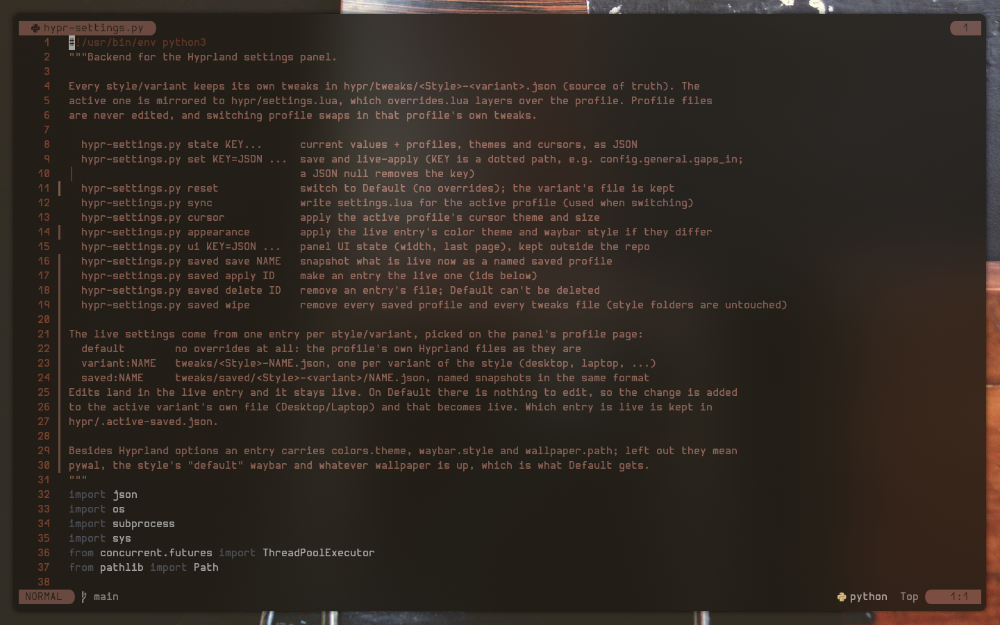
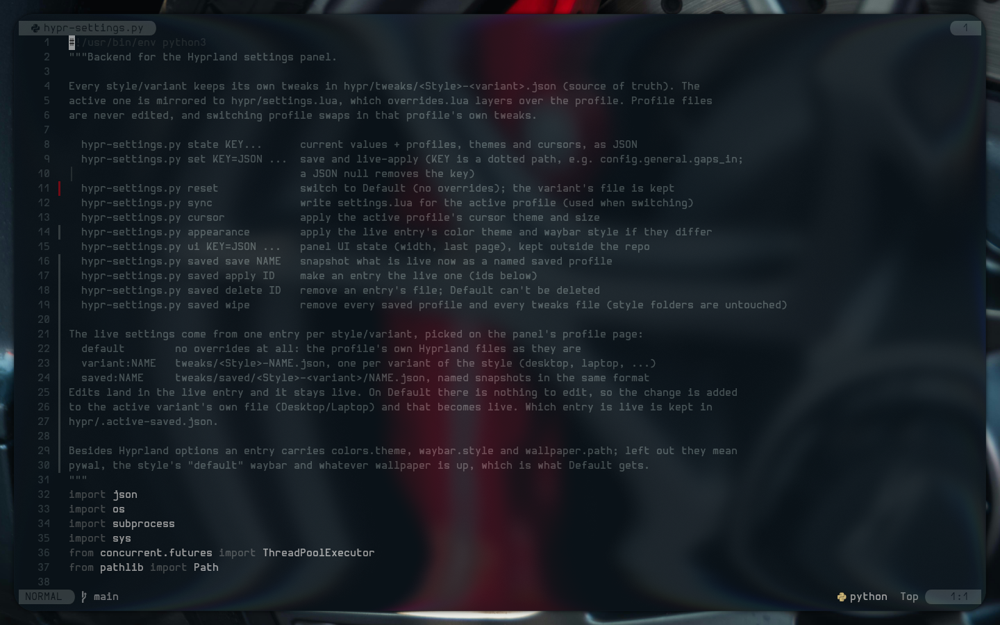
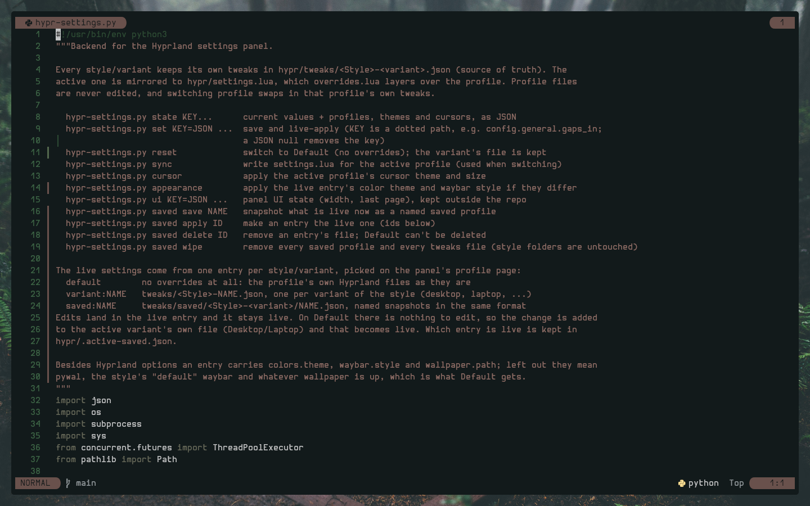
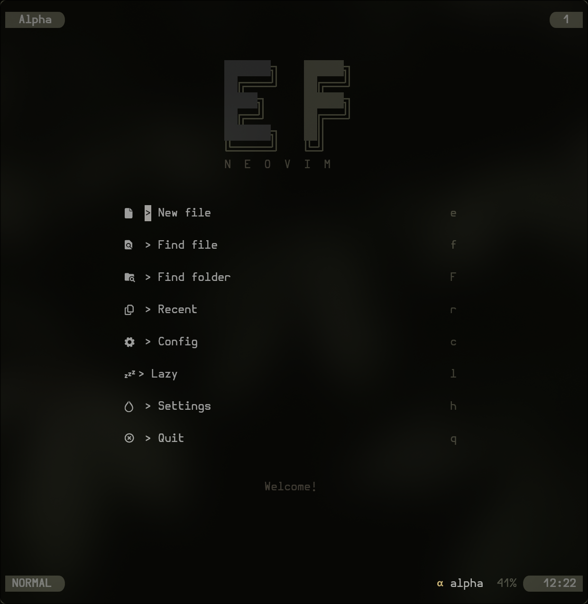
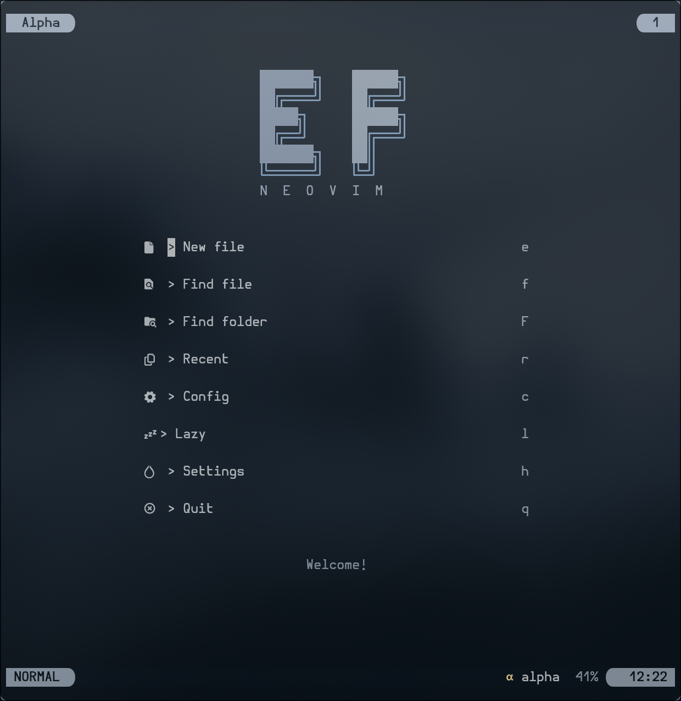
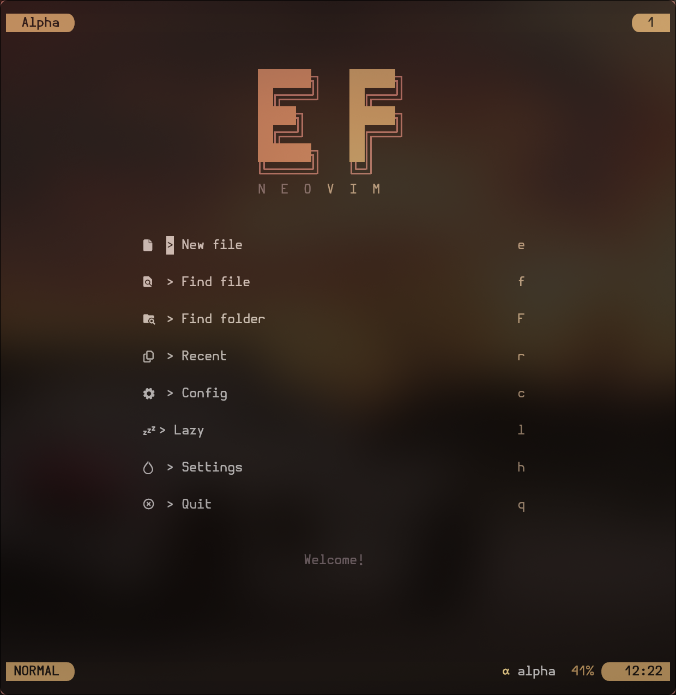

# MyNvim

My neovim config. pywal colors, lazy.nvim, and not much else in the way.

<p align="center">
  
  
  
</p>
<p align="center">
  
  
  
</p>

## Install

```sh
git clone https://github.com/elifouts/MyNvim ~/.config/nvim
nvim
```

Plugins install themselves on first launch.

